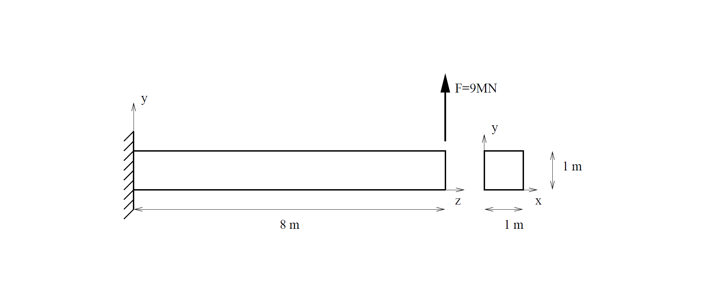
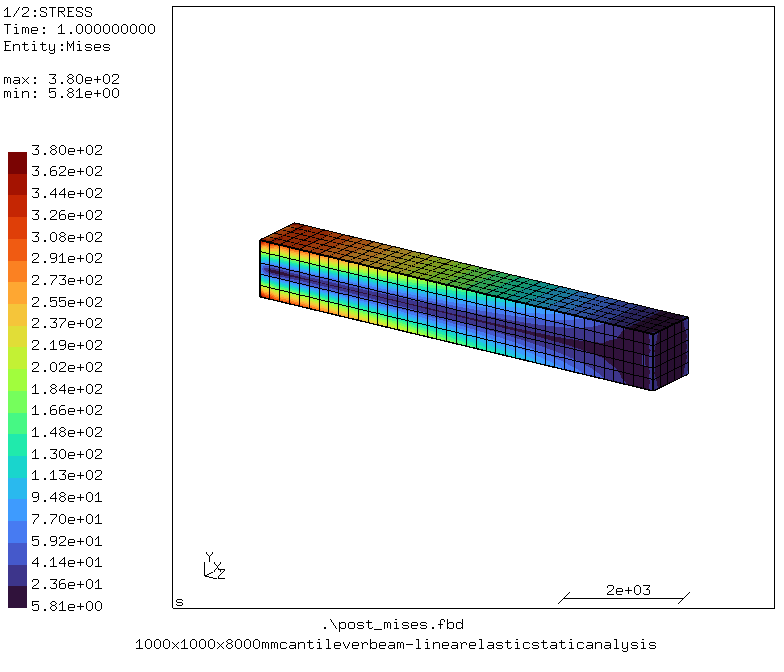

# Cantilever Beam
Tested with CGX 2.23/ CCX 2.23 (cgx_GLUT and ccx_STATIC) downloaded from https://www.dhondt.de/calculix_2.23_4win.zip

A cantilever beam loaded by point forces at its free end is analyzed. The problem is taken from the CalculiX 2.23 manual nd the geometry, loading and boundary conditions are shown in the 
figure below.



The beam size is 1000 x 1000 x 8000 mm<sup>3</sup>, which is loaded with a point force of 9x10<sup>6</sup> N and is completely fixed in all directions on the left end.

File                                                                    | Contents    
:-------------                                                          | :-------------
[cantilever_linearstatic.fbd](cantilever_linearstatic.fbd)              | Pre-processing script for CGX for generating cube and its mesh     
[cantilever_linearstatic.inp](cube_force_controlled.inp)                | CCX input of the simulation
[post_disp.fbd](expansion.fbd)                                          | Post-processing script for CGX (contour plot of displacement magnitude)
[post_mises.fbd](expansion.fbd)                                         | Post-processing script for CGX (contour plot of von Mises stress)
[post_Szz.fbd](expansion.fbd)                                           | Post-processing script for CGX (contour plot of stress in axial direction)

## Preprocessing
An example to run the displacement-controlled simulation. Elements of second order quadrilateral with reduced integration (C3D20R) are used.

Boundary conditions:
* Left end fixed in all direcitons: ux = uy = uz = 0 mm

Loading:
* Point force applied on the right end with 9x10<sup>6</sup> N

### Generating mesh and node sets

```
> cgx -b cantilever_linearstatic.fbd
```

## Solving
```
> ccx -i cantilever_linearstatic
```

## Post-processing
```
> cgx -b post_disp.fbd
```

This creates a contour plot of the displacement magnitude with a deformation factor of 10.


This figure shows the deformation of the bea, under the load. As expected, the beam bends due to the lateral force at its right end.

```
> cgx -b post_mises.fbd
```

This creates a contour plot of the von Mises stress.




```
> cgx -b post_Szz.fbd
```

This creates a contour plot of the stress in axial direction.


This figure shows the normal stress in axial direction, which is distributed almost linearly across the height of the beam due to the bending moment.