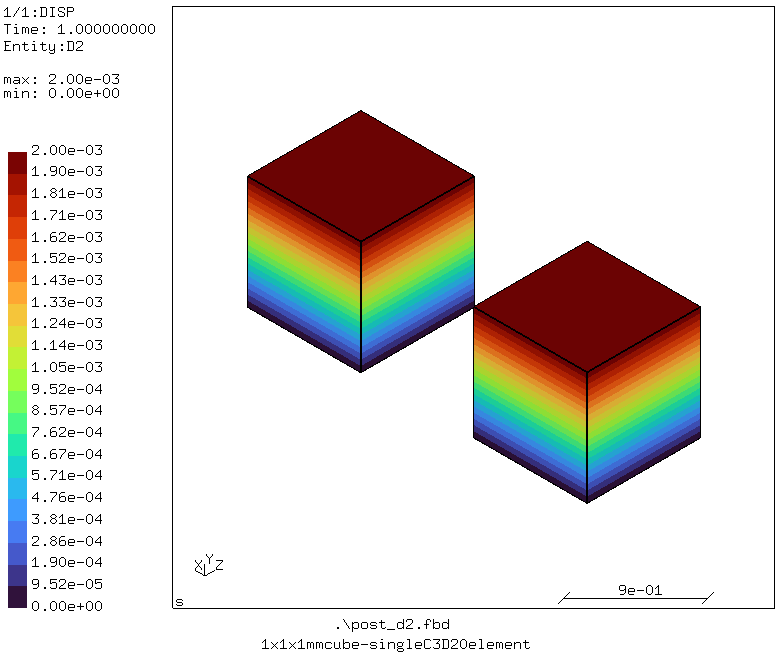
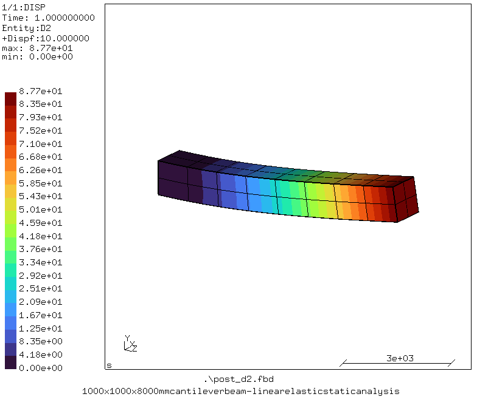

# CalculiX FEA Examples
A collection of finite element analysis (FEA) examples using **[CalculiX](http://www.dhondt.de/)**, an open-source finite element analysis solver.

[
  ](structural/linear_static/01_cube/)
[
](structural/linear_static/02_cantilever_beam/)

This repository demonstrates how to set up, run, and evaluate FEA simulations using practical engineering examples. It aims to provide a structured and accessible reference for learning finite element analysis, understanding simulation workflows, and exploring the capabilities of CalculiX.

## Prerequisites
* CalculiX GraphiX (cgx) and CrunchiX (ccx) 2.23, see [INSTALLATION](INSTALLATION_LINUX.md) for Ubuntu/Debian.

## Getting Started
1. Clone this repository:
```
git clone https://github.com/mkhan138/calculix-fea-examples
```

2. Navigate to an example directory:
```
cd ./calculix-fea-examples/structural/linear_static/01_cube/
```

3. Run the simulation using the CalculiX CrunchiX solver:
```
ccx -i cube_linearstatic.inp
```

4. Inspect the results with CalculiX GraphiX.
```
cgx -v cube_linearstatic.frd
```

See the individual example directories for model-specific instructions.

5. Execute the following from root directory for running all examples on this repository:
```
python run_all.py
```

## Repository Structure
```text
calculix-fea-examples/
└── structural/
    └── linear_static/
        ├── 01_cube/
        └── 02_cantilever_beam/
```

The repository is organized by physical domain and analysis type. Each example is intended to be self-contained, with its own model files, documentation, and relevant results.

## Validation and Accuracy
Where applicable, simulation results will be compared against analytical solutions, established benchmarks, or other reference data.

The examples are intended for educational and exploratory purposes. Results depend on the assumptions, material models, mesh quality, boundary conditions, and solver settings used in each case.

## Contributing
Suggestions, corrections, and additional examples are welcome. Contributions should include a clear description of the problem, the model assumptions, and instructions for reproducing the results.

## License
See the repository license for terms of use and redistribution.