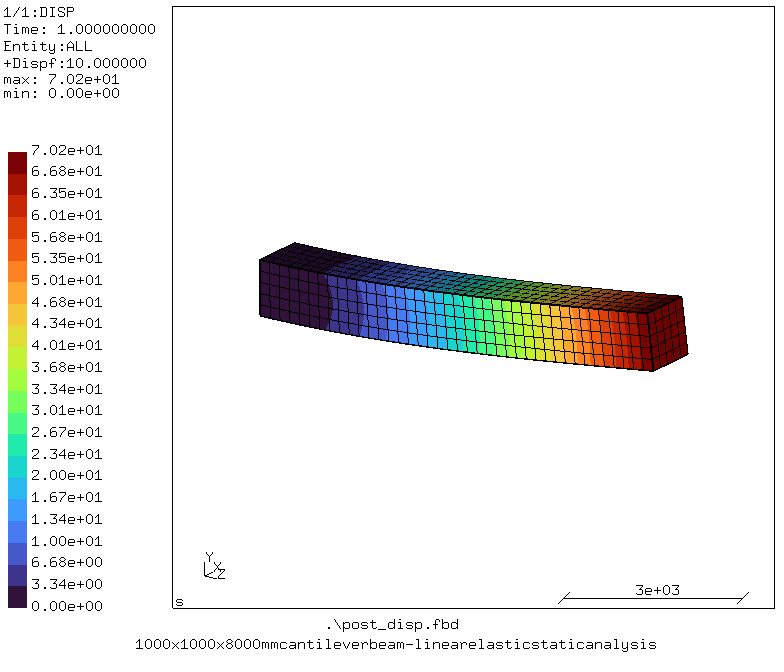

# Calculix FEA Examples
A collection of finite element analysis (FEA) examples using **[CalculiX](http://www.dhondt.de/)**, an open-source finite element analysis solver.

[
  ](structural/linear_static/01_cube/)
[
](structural/linear_static/02_cantilever_beam/)

This repository demonstrates how to set up, run, and evaluate FEA simulations using practical engineering examples. It aims to provide a structured and accessible reference for learning finite element analysis, understanding simulation workflows, and exploring the capabilities of CalculiX.

## Objectives
- Demonstrate the application of FEA to practical engineering problems.
- Explore different analysis types and their underlying physical principles.
- Provide clear, reproducible simulation examples.
- Compare numerical results with analytical solutions or reference data where applicable.
- Develop a growing collection of examples covering different aspects of CalculiX.

## Repository Structure
```text
calculix-fea-examples/
└── structural/
    └── linear_static/
        ├── 01_cube/
        └── 02_cantilever_beam/
```

The repository is organized by physical domain and analysis type. Each example is intended to be self-contained, with its own model files, documentation, and relevant results.

### Structural Analysis
**Linear Static Analysis**
The current collection focuses on linear static structural analysis, covering topics such as stress distribution, deformation, boundary conditions, and material behavior under static loading.

Further examples and analysis types will be added as the repository develops.

## Getting Started
1. Install CalculiX using the appropriate version for your operating system.
2. Clone this repository.
3. Navigate to an example directory.
4. Review the example documentation and input files.
5. Run the simulation using the CalculiX solver and inspect the results with a compatible postprocessor.

See the individual example directories for model-specific instructions.

## Planned Extensions
The repository is intended to expand beyond linear static structural analysis.

- [ ] Nonlinear static analysis
- [ ] Modal and frequency analysis
- [ ] Buckling analysis
- [ ] Dynamic analysis
- [ ] Thermal analysis
- [ ] Coupled thermomechanical analysis

Additional topics may be introduced as suitable examples are developed and validated.

## Validation and Accuracy
Where applicable, simulation results will be compared against analytical solutions, established benchmarks, or other reference data.

The examples are intended for educational and exploratory purposes. Results depend on the assumptions, material models, mesh quality, boundary conditions, and solver settings used in each case.

## Contributing
Suggestions, corrections, and additional examples are welcome. Contributions should include a clear description of the problem, the model assumptions, and instructions for reproducing the results.

## License
See the repository license for terms of use and redistribution.