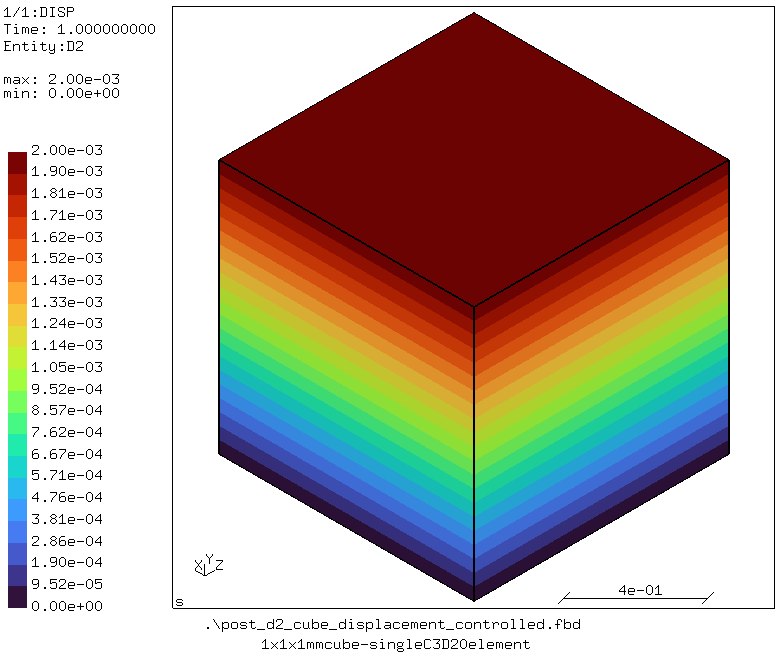
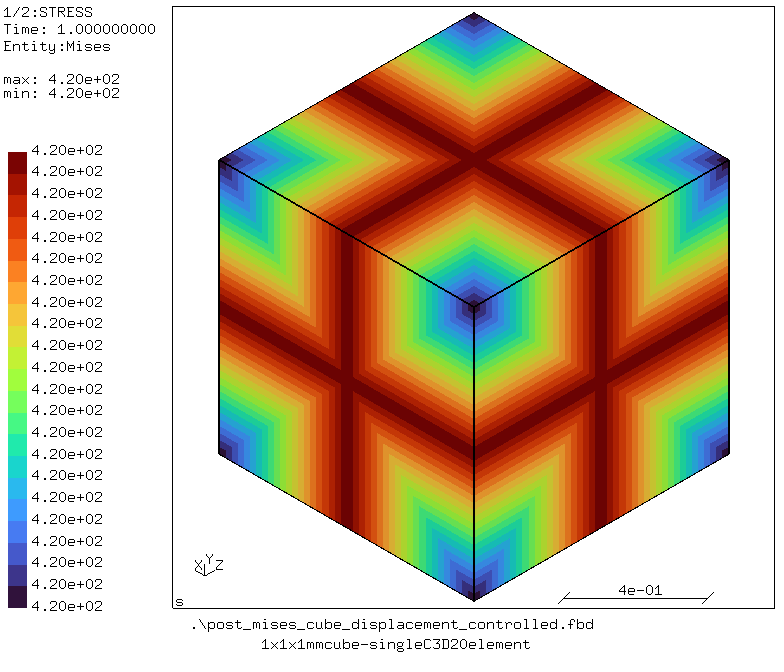

# Cube
Tested with CGX 2.23/ CCX 2.23

A cube of dimension 1x1x1 mm with a single C3D20 element is displaced by 0.002 mm in the case of displacement-controlled simulation. Similarly, in the case of force-controlled experiment 
a force of 420 N (equal to 420 N/mm<sup>2</sup> or 420 MPa) is applied. The simulation is linear elastic so according to Hooke's law, in the displacement-controlled case, a constant von Mises stress of 420 MPa is achieved, whereas in the force-controlled a case, the cube is displaced by 0.002 mm.

One face of the cube in each translational degree of freedom is constrained. The force and/or displacement is applied in the positive y-direction.

File                                                                    | Contents    
:-------------                                                          | :-------------
[cube.fbd](cube.fbd)                                                    | Pre-processing script for CGX for generating cube and its mesh     
[post_d2.fbd](expansion.fbd)                                            | Post-processing script for CGX (contour plot of displacement in y-direction)
[post_mises.fbd](expansion.fbd)                                         | Post-processing script for CGX (contour plot of von Mises stress in y-direction)
[cube_force_controlled.inp](cube_force_controlled.inp)                  | CCX input for force controlled simulation
[cube_displacement_controlled.inp](cube_displacement_controlled.inp)    | CCX input for displacement controlled simulation
[run_all.py](run_all.py)                                                | Run all commands to solve and view the simulations' results

## Preprocessing
An example to run the displacement-controlled simulation.

Second order quadrilateral fully integrated single element (C3D20) is used.

Boundary conditions:
* For one face in y-direction: uy = 0 mm
* For one face in x-direction: ux = 0 mm
* For one face in z-direction: uz = 0 mm
* For the opposite face in y-direction: uy = 0.002 mm

### Generating mesh and node sets

```
> cgx -b cube.fbd
```

## Solving
```
> ccx -i cube_displacement_controlled
```

## Postprocessing
```
> cgx -b post_d2
```

This creates a contour plot of the displacement in axial direction.



```
> cgx -b post_mises
```

This creates a contour plot of the von Mises stress.



## Run complete project
To run the complete project, run:
```
> py run_all.py
```